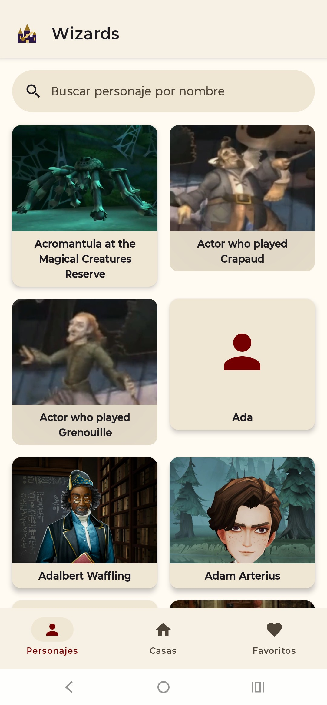
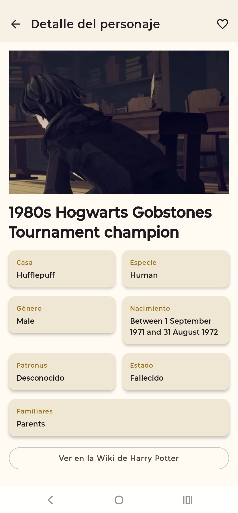
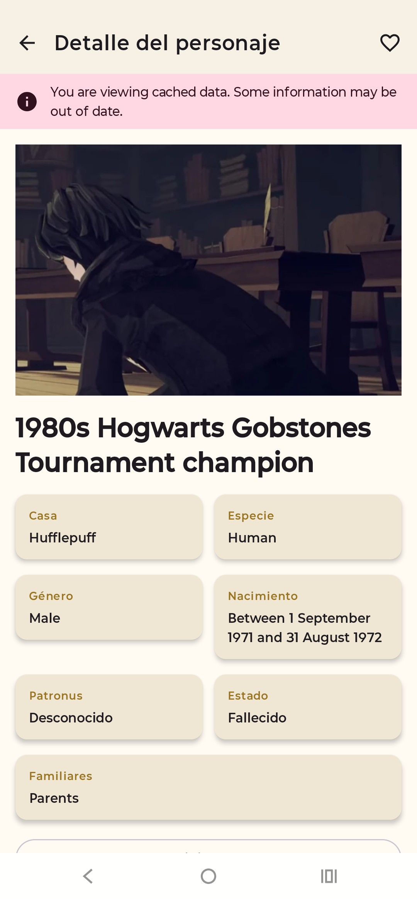

# WizardWorld

App **Kotlin Multiplatform** (Android + iOS) para explorar los personajes y las casas del mundo de Harry Potter.
Permite listar personajes con búsqueda y paginación, ver el detalle de cada uno, marcar favoritos y consultar las casas de Hogwarts.
Todo funciona **sin conexión** gracias a una caché local con SQLDelight.

---

## Índice

- [API elegida](#api-elegida)
- [Arquitectura y justificación](#arquitectura-y-justificación)
- [Cómo compilar y testear](#cómo-compilar-y-testear)
- [Integrantes](#integrantes)
- [Capturas](#capturas)

---

## API elegida

### Personajes: PotterDB

Base URL: `https://api.potterdb.com/v1/` (cliente en [`HpApi.kt`](./sharedLogic/src/commonMain/kotlin/com/example/wizardworld/data/remote/HpApi.kt))

| Endpoint | Uso | Parámetros |
|---|---|---|
| `GET /characters` | Lista de personajes | `filter[name_cont]` (búsqueda por nombre), `page[number]`, `page[size]` (paginación) |
| `GET /characters/{id}` | Detalle de un personaje | `id` del personaje |

### Casas: Wizard World API

Base URL: `https://wizard-world-api.herokuapp.com/` (usado en [`HouseRepositoryImpl.kt`](./sharedLogic/src/commonMain/kotlin/com/example/wizardworld/data/repository/HouseRepositoryImpl.kt))

| Endpoint | Uso |
|---|---|
| `GET /Houses` | Lista de casas |
| `GET /Houses/{id}` | Detalle de una casa |

> **Nota sobre el cambio de API:** al principio los personajes se obtenían de la Wizard World API con `GET /Wizards` y `GET /Wizards/{id}`
> ([`WizardWorldApi.kt`](./sharedLogic/src/commonMain/kotlin/com/example/wizardworld/data/remote/WizardWorldApi.kt)).
> Como `/Wizards` solo devuelve nombre, apellido y elixires (sin imagen, casa ni datos biográficos), en el issue [#44](https://github.com/LucasGA10/WizardWorld/issues/44)
> se migró a **PotterDB**, que trae toda la información que necesitan la lista y el detalle.

### Campos que se muestran

**Lista de personajes** ([`CharacterItemCard`](./sharedUI/src/commonMain/kotlin/com/example/wizardworld/ui/screens/characters/components/CharacterItemCard.kt)):

- Imagen (`image`)
- Nombre (`name`)
- Casa (`house`)

**Detalle del personaje** ([`CharacterDetailScreen`](./androidApp/src/main/kotlin/com/example/wizardworld/ui/screens/characters/CharacterDetailScreen.kt)):

- Imagen y nombre
- Casa, especie, género, fecha de nacimiento, patronus y estado (vivo / fallecido)
- Animago y boggart (si tiene)
- Títulos, trabajos, familiares y romances (si tiene)
- Varitas
- Enlace a la wiki de Harry Potter
- Botón para agregar / quitar de favoritos

---

## Arquitectura y justificación

### Módulos

| Módulo | Contenido |
|---|---|
| [`sharedLogic`](./sharedLogic/src) | Lógica compartida: capas **data**, **domain** y **presentation** (ViewModels), DI con Koin y base de datos SQLDelight |
| [`sharedUI`](./sharedUI/src) | UI compartida en Compose Multiplatform: lista de personajes, tema y componentes comunes (`OfflineBanner`, `ErrorState`, `EmptyState`, shimmer) |
| [`androidApp`](./androidApp/src) | App Android: navegación con barra inferior, detalle de personaje, favoritos y pantallas de casas |
| [`iosApp`](./iosApp) | Punto de entrada de la app iOS |

### Capas: MVVM + Clean Architecture

```
┌──────────────────────────── presentation ────────────────────────────┐
│  Screen (Compose)  ──observa──▶  ViewModel  ──expone──▶  UiState<T>    │
└──────────────────────────────────┬────────────────────────────────────┘
                                   │ invoca
┌─────────────────────────────── domain ───────────────────────────────┐
│  UseCase  ──▶  Repository (interfaz)        Modelos: HpCharacter,...  │
└──────────────────────────────────┬────────────────────────────────────┘
                                   │ implementa
┌──────────────────────────────── data ────────────────────────────────┐
│  RepositoryImpl ──▶ Api (Ktor + DTOs + mappers)                       │
│                 └─▶ LocalDataSource (SQLDelight)                      │
└───────────────────────────────────────────────────────────────────────┘
```

- **data**: habla con el mundo exterior. Clientes Ktor (`HpApi`, `WizardWorldApi`), DTOs serializados con kotlinx.serialization, mappers DTO → dominio, data sources locales sobre SQLDelight e implementaciones de los repositorios.
- **domain**: modelos puros (`HpCharacter`, `House`, ...), interfaces de repositorio y casos de uso. No depende de Ktor, SQLDelight ni de la UI.
- **presentation**: ViewModels compartidos que combinan casos de uso y exponen `StateFlow<UiState<T>>` a las pantallas.

**Por qué:** separar en capas hace que cada pieza tenga una sola responsabilidad y se pueda testear por separado
(los repositorios con `MockEngine` y una DB en memoria, los ViewModels con repositorios falsos).
Además, al vivir en `sharedLogic`, toda esta lógica se comparte entre Android e iOS y solo la UI es específica de cada plataforma.
MVVM encaja naturalmente con Compose: la pantalla solo observa estado y envía eventos al ViewModel.

### Un repositorio por categoría

| Repositorio | Responsabilidad |
|---|---|
| `CharacterRepository` | Lista paginada / búsqueda de personajes y detalle |
| `HouseRepository` | Lista y detalle de casas |
| `FavoriteRepository` | Personajes favoritos guardados localmente |

Las interfaces están en `domain/repository` y las implementaciones en `data/repository`.
Cada categoría evoluciona de forma independiente (por ejemplo, el cambio de API de personajes a PotterDB no tocó nada de casas) y es fácil reemplazarlas por fakes en los tests.

### Casos de uso

`GetCharactersUseCase`, `GetCharacterDetailUseCase`, `GetHousesUseCase`, `GetHouseUseCase`,
`ToggleFavoriteUseCase`, `ObserveFavoriteIdsUseCase` y `ObserveFavoriteCharactersUseCase`.

Cada caso de uso representa una acción concreta del usuario. Los ViewModels dependen de ellos y no de los repositorios,
así la lógica de negocio queda en el dominio, los ViewModels quedan chicos y cada acción se puede testear sola.

### `Resource` → `UiState`

- [`Resource<T>`](./sharedLogic/src/commonMain/kotlin/com/example/wizardworld/core/Resource.kt) es lo que emiten los repositorios: `Loading`, `Success(data)`, `Offline(data, message)` (falló la red pero hay caché) y `Error(message)` (falló la red y no hay caché).
- [`UiState<T>`](./sharedLogic/src/commonMain/kotlin/com/example/wizardworld/presentation/UiState.kt) es lo que consume la pantalla: `Loading`, `Success(data, isOffline)`, `Error(message)` y `Empty`.
- La extensión `Resource.toUiState(isEmpty)` hace la conversión: `Offline` se transforma en `Success(isOffline = true)` y una lista vacía en `Empty`.

**Por qué:** la capa de datos describe *de dónde* salió el dato y la UI solo necesita saber *qué mostrar*.
Así las pantallas no conocen detalles de red o caché: muestran el contenido y, si `isOffline` es `true`, el `OfflineBanner`.

### Caché network-first con SQLDelight

Todos los repositorios siguen la misma estrategia:

1. Emiten `Loading`.
2. Piden los datos a la API.
3. Si responde bien → guardan en SQLDelight y emiten `Success`.
4. Si falla (sin conexión, error del servidor, rate limit) → leen la caché:
   - con datos → `Offline` (la UI muestra los datos y el banner "sin conexión");
   - sin datos → `Error` (la UI muestra el estado de error con reintento).

Las tablas están en [`sharedLogic/src/commonMain/sqldelight`](./sharedLogic/src/commonMain/sqldelight/com/example/wizardworld/db) (personajes, casas y favoritos) con sus migraciones `.sqm`.

**Por qué network-first:** los datos siempre se muestran actualizados cuando hay conexión y la app sigue siendo usable sin ella.
SQLDelight genera código Kotlin tipado desde SQL y funciona en Android e iOS, por eso encaja con KMP.

### Stack

Kotlin Multiplatform · Compose Multiplatform · Ktor · kotlinx.serialization · SQLDelight · Koin · Coil · Navigation Compose

---

## Cómo compilar y testear

Requisitos: JDK 17 y Android SDK.

```bash
# Compilar la app Android (APK debug)
./gradlew :androidApp:assembleDebug

# Tests unitarios de la lógica compartida
./gradlew :sharedLogic:testAndroidHostTest

# Tests de la UI compartida
./gradlew :sharedUI:testAndroidHostTest
```

> En Windows usar `gradlew.bat` en lugar de `./gradlew`.
> Para iOS, abrir [`/iosApp`](./iosApp) en Xcode y ejecutar desde ahí.

Los tests cubren: deserialización de DTOs, clientes de API con `MockEngine` de Ktor, repositorios con caché offline (DB SQLite en memoria),
favoritos, casos de uso, la conversión `Resource → UiState` y el `CharacterListViewModel`.

El CI ([`.github/workflows/ci.yml`](./.github/workflows/ci.yml)) corre los tests y el build de Android en cada PR y en cada push a `develop`.

---

## Integrantes

| Nombre | GitHub | Issues | PRs |
|---|---|---|---|
| Rocío Daniela Vera | [@RocioDanielaVera](https://github.com/RocioDanielaVera) | [#2](https://github.com/LucasGA10/WizardWorld/issues/2), [#4](https://github.com/LucasGA10/WizardWorld/issues/4), [#5](https://github.com/LucasGA10/WizardWorld/issues/5), [#6](https://github.com/LucasGA10/WizardWorld/issues/6), [#7](https://github.com/LucasGA10/WizardWorld/issues/7), [#9](https://github.com/LucasGA10/WizardWorld/issues/9), [#25](https://github.com/LucasGA10/WizardWorld/issues/25), [#28](https://github.com/LucasGA10/WizardWorld/issues/28), [#34](https://github.com/LucasGA10/WizardWorld/issues/34) | [#16](https://github.com/LucasGA10/WizardWorld/pull/16), [#24](https://github.com/LucasGA10/WizardWorld/pull/24), [#49](https://github.com/LucasGA10/WizardWorld/pull/49), [#50](https://github.com/LucasGA10/WizardWorld/pull/50) |
| Juliana Samaniego | [@JSama28](https://github.com/JSama28) | [#21](https://github.com/LucasGA10/WizardWorld/issues/21), [#26](https://github.com/LucasGA10/WizardWorld/issues/26), [#27](https://github.com/LucasGA10/WizardWorld/issues/27), [#46](https://github.com/LucasGA10/WizardWorld/issues/46), [#47](https://github.com/LucasGA10/WizardWorld/issues/47), [#54](https://github.com/LucasGA10/WizardWorld/issues/54) | [#31](https://github.com/LucasGA10/WizardWorld/pull/31), [#48](https://github.com/LucasGA10/WizardWorld/pull/48), [#51](https://github.com/LucasGA10/WizardWorld/pull/51), [#52](https://github.com/LucasGA10/WizardWorld/pull/52), [#56](https://github.com/LucasGA10/WizardWorld/pull/56), [#60](https://github.com/LucasGA10/WizardWorld/pull/60) |
| Lucas | [@LucasGA10](https://github.com/LucasGA10) | [#1](https://github.com/LucasGA10/WizardWorld/issues/1), [#3](https://github.com/LucasGA10/WizardWorld/issues/3), [#15](https://github.com/LucasGA10/WizardWorld/issues/15), [#17](https://github.com/LucasGA10/WizardWorld/issues/17), [#20](https://github.com/LucasGA10/WizardWorld/issues/20), [#32](https://github.com/LucasGA10/WizardWorld/issues/32), [#44](https://github.com/LucasGA10/WizardWorld/issues/44), [#53](https://github.com/LucasGA10/WizardWorld/issues/53), [#58](https://github.com/LucasGA10/WizardWorld/issues/58) | [#13](https://github.com/LucasGA10/WizardWorld/pull/13), [#29](https://github.com/LucasGA10/WizardWorld/pull/29), [#33](https://github.com/LucasGA10/WizardWorld/pull/33), [#42](https://github.com/LucasGA10/WizardWorld/pull/42), [#43](https://github.com/LucasGA10/WizardWorld/pull/43), [#45](https://github.com/LucasGA10/WizardWorld/pull/45), [#57](https://github.com/LucasGA10/WizardWorld/pull/57) |
| Aguirre | [@palocipriano](https://github.com/palocipriano) | [#5](https://github.com/LucasGA10/WizardWorld/issues/5), [#8](https://github.com/LucasGA10/WizardWorld/issues/8), [#19](https://github.com/LucasGA10/WizardWorld/issues/19), [#23](https://github.com/LucasGA10/WizardWorld/issues/23) | [#30](https://github.com/LucasGA10/WizardWorld/pull/30), [#35](https://github.com/LucasGA10/WizardWorld/pull/35) |
| Franco Viscarret | [@FrancoViscarret](https://github.com/FrancoViscarret) | [#10](https://github.com/LucasGA10/WizardWorld/issues/10), [#11](https://github.com/LucasGA10/WizardWorld/issues/11), [#12](https://github.com/LucasGA10/WizardWorld/issues/12) | [#14](https://github.com/LucasGA10/WizardWorld/pull/14) |

---

## Capturas

| Lista de personajes | Detalle del personaje | Modo offline |
|:---:|:---:|:---:|
|  |  |  |
